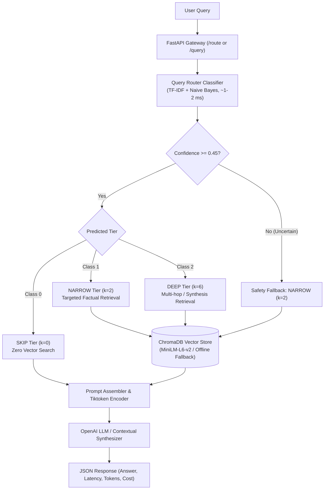

# Adaptive RAG Optimizer & Gateway

[](https://www.python.org/)
[](https://fastapi.tiangolo.com/)
[](https://www.trychroma.com/)
[](https://scikit-learn.org/)
[](LICENSE)
[](#)

An intelligent, latency-optimized Retrieval-Augmented Generation (RAG) backend engineered to dynamically allocate retrieval chunk budgets ($k \in \{0, 2, 6\}$) based on incoming query complexity.

---

## 📖 Executive Summary

Conventional RAG pipelines query vector databases with a fixed chunk budget (e.g., $k=5$) regardless of whether a user is asking a basic arithmetic question, requesting a single policy date, or seeking an exhaustive multi-quarter financial synthesis.

### The Inefficiencies of Static RAG:

1. **Unnecessary Token Bloat**: Closed-book questions ("What is 25 * 48?") do not require external context. Ingesting $k=5$ chunks into the prompt inflates token consumption by up to **80%**.
2. **Context Poisoning & Latency Penalties**: Irrelevant context chunks add unnecessary vector search latency and can distract the LLM generator.
3. **Under-Retrieval on Complex Queries**: Complex multi-hop queries often need deeper retrieval than a shallow static $k$ can supply.

### The Adaptive RAG Solution:

**Adaptive RAG Optimizer** deploys a ultra-lightweight, sub-millisecond machine learning classifier at the ingestion gateway. Queries are dynamically routed to three retrieval tiers:

- **`SKIP` ($k=0$)**: Bypass vector search completely for closed-book, reasoning, or chit-chat queries.
- **`NARROW` ($k=2$)**: Retrieve minimal targeted context for direct factual lookups.
- **`DEEP` ($k=6$)**: Retrieve broader context for synthesis, comparisons, and complex reasoning.
- **Uncertainty Guardrail**: Automatically promotes predictions with low classification confidence ($< 0.45$) to `NARROW` ($k=2$) to ensure answer safety.

---

## 🏗️ Architecture & Query Lifecycle



---

## ⚡ Key Features

- **Dynamic Chunk Budget Routing**: Classifies queries across $k \in \{0, 2, 6\}$ with sub-2ms overhead.
- **Average Token Savings of ~38.7%**: Up to **83.8% token reduction** on closed-book and simple queries.
- **Offline-First & Dual-Backend Vector Store**:
  - Primary: `sentence-transformers/all-MiniLM-L6-v2` (384-dimensional dense embeddings).
  - Fallback: Deterministic `LocalFallbackEmbeddingFunction` based on scikit-learn's `HashingVectorizer` for zero-download offline testing.
- **Atomic Corpus Publishing & Stale Purging**:
  - Calculates SHA-256 fingerprint (`corpus_revision`) from sorted documents.
  - Automatically identifies and purges stale documents from existing collections.
  - Documents are ingested under `"building"` state and verified before being transitioned to `"ready"`.
- **Fault-Tolerant Async FastAPI Gateway**:
  - Monotonic clock cooldown retry mechanism (`time.monotonic()`) preventing cascading startup crashes if dependencies fail.
  - Non-blocking async endpoints (`asyncio.to_thread`) preserving FastAPI concurrency.
  - Full OpenAPI 3.1 & Swagger UI compliance.
- **Built-in Static Code Auditor**: Includes an AST-driven inspection utility (`scripts/audit_code.py`) that checks for unused imports, dead variables, and scope leaks across modules.

---

## 📊 Action Tiers & Cost Model

| Tier         | Class ID | Chunk Budget ($k$) | Intended Query Complexity              | Avg. Input Tokens | Tier Cost (USD) | Example Query                                                                      |
| ------------ | :------: | :----------------: | -------------------------------------- | :---------------: | :-------------: | ---------------------------------------------------------------------------------- |
| **`SKIP`**   |   `0`    |        $0$         | Closed-book, arithmetic, definitions   |        ~27        |    \$0.0005     | _"What is 25 _ 48?"\*                                                              |
| **`NARROW`** |   `1`    |        $2$         | Direct factual policy / product lookup |        ~83        |    \$0.0020     | _"What is the EU cooling-off period for digital goods?"_                           |
| **`DEEP`**   |   `2`    |        $6$         | Cross-document analysis, synthesis     |       ~200        |    \$0.0060     | _"Compare churn rates across Q1, Q2, and Q3 and explain why each shift happened."_ |

---

## 📈 Empirical Benchmark Results

Running `src/benchmark.py` directly compares **Adaptive RAG** against a conventional **Static ($k=5$) baseline**:

```text
================================================================================
ADAPTIVE RAG BENCHMARK RESULTS
================================================================================
                                 query  adapt_k  static_tok  adapt_tok  token_saved_%  static_ms  adapt_ms  router_ms
                      What is 25 * 48?        0         167         27           83.8     148.37     72.46      72.33
      Define idempotency in REST APIs.        0         163         27           83.4      28.10      2.22       2.14
What is the EU cooling-off period f...        2         163         83           49.1      29.11     28.73       1.96
What encryption standard is used fo...        2         168         88           47.6      27.69     28.80       1.80
Compare churn rates across Q1, Q2, ...        6         184        210          -14.1      31.54     35.08       2.32
List all refund conditions across U...        6         168        197          -17.3      63.60     36.52       2.36
================================================================================
Average Input Token Reduction: 38.7%
```

> [!NOTE]
> For complex queries (_Class 2_), adaptive mode intentionally allocates slightly more tokens ($k=6$ vs static $k=5$) to guarantee multi-document coverage and avoid hallucination. The net efficiency across general workloads yields an average **38.7% token reduction**.

---

## 📂 Project Structure

```
Adaptive-RAG-Optimizer/
├── data/
│   ├── knowledge_base.json         # Knowledge base documents (policies, SLA, security)
│   └── router_dataset.csv          # Labeled queries dataset (query, class_label)
├── models/
│   └── query_router.joblib         # Serialized scikit-learn classifier pipeline
├── src/
│   ├── __init__.py
│   ├── ingest.py                   # Vector store ingestion with dual-backend & atomic tags
│   ├── train_router.py             # Router model training pipeline
│   ├── pipeline.py                 # Core AdaptiveRAGEngine & retrieval orchestration
│   ├── benchmark.py                # Comparative benchmark suite
│   └── main.py                     # FastAPI REST API implementation
├── tests/
│   └── test_api.py                 # Comprehensive unit & integration test suite
├── scripts/
│   └── audit_code.py               # Custom AST-based static code auditor
├── chroma_db/                      # Persistent ChromaDB vector store
├── requirements.txt                # Python package dependencies
├── .env                            # Environment variables (offline flags, keys)
├── .gitignore
├── LICENSE
└── README.md
```

---

## 🚀 Getting Started

### 1. Prerequisites & Environment Setup

Clone the repository and prepare a Python 3.10+ virtual environment:

```bash
git clone https://github.com/your-username/Adaptive-RAG-Optimizer.git
cd Adaptive-RAG-Optimizer

# Create and activate virtual environment
python -m venv .venv

# On Linux/macOS:
source .venv/bin/activate
# On Windows (PowerShell):
.\.venv\Scripts\Activate.ps1
```

### 2. Install Dependencies

```bash
pip install -r requirements.txt
```

### 3. Environment Configuration (`.env`)

Create or update `.env` in the project root:

```env
OPENAI_API_KEY=${OPENAI_API_KEY}
HF_HUB_OFFLINE=1
HF_HUB_DISABLE_SYMLINKS_WARNING=1
```

> [!TIP]
> If `OPENAI_API_KEY` is not provided or set to a placeholder, the engine gracefully defaults to synthetic contextual output, allowing full pipeline execution and testing without requiring paid API keys.

---

## 🛠️ Step-by-Step Execution Guide

### Step 1: Train the Complexity Router

Train the TF-IDF and Naive Bayes classifier on the labeled query dataset:

```bash
python src/train_router.py
```

_Output: Saves the trained model to `models/query_router.joblib`._

### Step 2: Ingest Documents into Vector Store

Ingest `data/knowledge_base.json` into ChromaDB:

```bash
python src/ingest.py
```

_Output: Builds `company_docs` with `all-MiniLM-L6-v2` and fallback `company_docs_fallback` with revision fingerprints._

### Step 3: Run Comparative Benchmarks

Evaluate latency and token savings against the baseline:

```bash
python src/benchmark.py
```

### Step 4: Run the Test Suite

Execute the comprehensive offline-safe test suite:

```bash
python tests/test_api.py --direct
```

Runs 7 test scenarios including route classification, adaptive retrieval, 503 error handling, ASGI transport, and monotonic clock cooldown retries.

### Step 5: Launch the FastAPI Gateway Server

Start the web service:

```bash
python -m uvicorn src.main:app --host 0.0.0.0 --port 8000 --reload
```

- **Interactive API Documentation (Swagger UI)**: [http://localhost:8000/docs](http://localhost:8000/docs)
- **Alternative Documentation (ReDoc)**: [http://localhost:8000/redoc](http://localhost:8000/redoc)

---

## 🔌 API Reference

### 1. Health & Readiness Check

**`GET /health`**

Inspect server status, model loading state, and active tier configurations.

```bash
curl -X GET http://127.0.0.1:8000/health
```

**Response (200 OK):**

```json
{
  "status": "healthy",
  "engine_loaded": true,
  "action_tiers": {
    "0": { "name": "SKIP", "k": 0, "tier_cost_usd": 0.0005 },
    "1": { "name": "NARROW", "k": 2, "tier_cost_usd": 0.002 },
    "2": { "name": "DEEP", "k": 6, "tier_cost_usd": 0.006 }
  }
}
```

---

### 2. Route Query Endpoint

**`POST /route`**

Classifies the query and returns the recommended retrieval tier without executing retrieval.

```bash
curl -X POST http://127.0.0.1:8000/route \
  -H "Content-Type: application/json" \
  -d '{"query": "What is the EU cooling-off period for digital goods?"}'
```

**Response (200 OK):**

```json
{
  "class_id": 1,
  "tier": "NARROW",
  "k": 2,
  "tier_cost_usd": 0.002,
  "confidence": 0.737,
  "router_latency_ms": 1.67
}
```

---

### 3. Full Query & Retrieval Endpoint

**`POST /query`**

Routes the query, retrieves chunks if $k > 0$, and synthesizes the final response.

#### Adaptive Mode Request:

```bash
curl -X POST http://127.0.0.1:8000/query \
  -H "Content-Type: application/json" \
  -d '{
    "query": "What is the EU cooling-off period for digital goods?",
    "mode": "adaptive"
  }'
```

**Response (200 OK):**

```json
{
  "mode": "adaptive",
  "query": "What is the EU cooling-off period for digital goods?",
  "answer": "Under EU consumer directives, customers have a 14-day cooling-off period for digital goods...",
  "k_used": 2,
  "input_tokens": 83,
  "router_ms": 1.97,
  "retrieval_ms": 28.73,
  "total_latency_ms": 32.5,
  "tier_cost_usd": 0.002
}
```

#### Static Override Request ($k=3$):

```bash
curl -X POST http://127.0.0.1:8000/query \
  -H "Content-Type: application/json" \
  -d '{
    "query": "What is the EU cooling-off period for digital goods?",
    "mode": "static",
    "static_k": 3
  }'
```

---

## 🛡️ Reliability & Resilience Engineering

1. **Monotonic Clock Cooldown (`RETRY_COOLDOWN_SECONDS = 2.0`)**:
   If an initialization failure occurs, subsequent requests fail fast without repeatedly triggering heavy disk/GPU operations until the cooldown window expires.
2. **Double-Checked Locking**:
   Thread-safe lazy initialization ensures only one worker thread initializes the models during cold starts.
3. **ChromaDB 0.6.x & Backward Compatibility**:
   Safely handles `client.list_collections()` whether string names or collection objects are returned.
4. **Stale Chunk Protection**:
   Vector ingestion performs set-difference analysis against existing document IDs, purging deleted entries before marking the collection as `"ready"`.

---

## 🔍 Static Code Audit

Run the custom AST audit tool to detect unused variables, imports, and scope issues:

```bash
python scripts/audit_code.py
```

---

## 📄 License

This project is licensed under the [MIT License](LICENSE).
